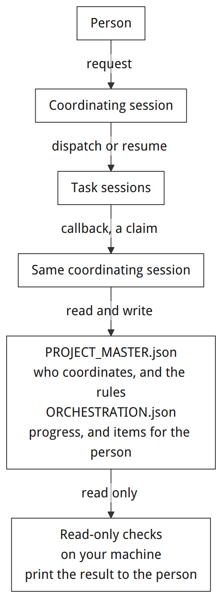
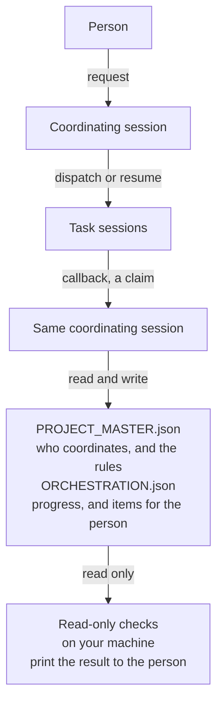

English | [简体中文](README.zh-CN.md)

# PMOP

PMOP is an experimental operating agreement for a multi-task project: one coordinating session, two JSON files in the project, and a few read-only checks.



<details>
<summary>Diagram source</summary>



</details>

The coordinating session reads and writes both files. `validate` and `owner-inbox` in `scripts/orchestration_state.py` run on your machine and only read them. A task session, called a child task in the rest of this document, writes `ORCHESTRATION.json` only when its handoff names that file and a revision.

A project split across agent chats leaves the next session to reconstruct who owns each result, what was already accepted, and which decisions are still waiting on a person. PMOP stores that record in the project directory: `PROJECT_MASTER.json` for identity and policy, `ORCHESTRATION.json` for current outcomes and owner gates, and [SKILL.md](SKILL.md) for how the coordinating session takes a request, routes it, hands it off, checks it, and passes the role on.

It is for someone who already works with an agent and wants one entry per project for incoming requests, routing, acceptance, and the decisions that need a person. Following it means reading the agreement and keeping the two files in the project.

## What it is, and what it is not

**In this repository**

- A written agreement: [SKILL.md](SKILL.md) plus the three contracts in [references/](references/).
- Two JSON files you keep in the project. The copies in [templates/](templates/) are fictional starting points.
- Three standard-library scripts: `orchestration_state.py` checks a project or prints an owner inbox, `capability_index.py` lists `SKILL.md` files under directories you name, and `demo.py` runs a throwaway demo.
- Manual notes for mapping the agreement onto Codex or Hermes. See [adapters/README.md](adapters/README.md).

**Outside this repository**

- Creating tasks, running agents, scheduling work, enforcing permissions, or syncing projects.
- Proof that work is finished, that an authorization is real, or that a piece of evidence is true. A passing check covers the structural rules in `scripts/orchestration_state.py`.
- A finished host integration. The Codex and Hermes notes come from reading an interface. The certification steps in the adapter contract are still open. Claude is listed as a planned host, with no interface reading and no run in the verification record.
- Standing permission to open child chats, commit, or take external actions. The published template sets child threads to `manual`, and sets both local commits and external actions to `owner_confirmation`.

"Protocol" in this project means that written agreement. The scripts are local checks.

## Quick start

Requires Python 3.10 or newer. Nothing to install. From the repository root:

```sh
python3 scripts/demo.py
python3 -m unittest discover -s tests -v
python3 scripts/capability_index.py --root . --format json
python3 scripts/capability_index.py --root ./examples --format json
```

On Windows, use `python` when `python3` is not on your PATH. The arguments stay the same.

- `demo.py` reads the fictional templates in this repository, writes a project into a temporary directory, checks it, prints one owner decision, and deletes that directory. It reads no host settings. The status line is English. The inbox headings are Chinese (`需要我亲手操作`, `需要我拍板`). The sample decision text is English, matching the fictional gate in `scripts/demo.py`.
- The unittest command runs the suite in [tests/](tests/).
- The inventory of `.` lists each `SKILL.md` under that path, with a relative path, size, and SHA-256. In this repository that is the root `SKILL.md`. The status string is `installed files only; runtime visibility unverified`.
- The inventory of `./examples` is an empty list. That directory has no `SKILL.md`. The script searches only the directories you name. Omitting `--root` exits 2.

## Concepts

| Piece | Role |
| --- | --- |
| Logical master | One per project. Receives requests, routes work, accepts results, and can hand the role to a successor session. |
| `PROJECT_MASTER.json` | Stable id, display name, governance directory, code directories, current master thread, and policy. Templates use schema version 2. Schema version 1 still passes, with a warning. |
| `ORCHESTRATION.json` | Revision, governance status, active outcomes, open owner gates, and pointers to older sources. Schema version is 1. The template allows three active outcomes, which is also the hard maximum. A project can set a lower `max_active_outcomes`. |
| Governance directory | The directory that holds the two JSON files. It can differ from the code directories where work actually runs. |
| Active outcome | A current result: stable `outcome_key`, priority, route, child thread, scope, last check, and next action. Priorities are unique and run from 1 with no gaps. |
| Owner gate | An open item the owner must personally do (`owner_action`) or decide from evidence (`owner_decision`). Ordinary agent work stays off this list. Live entries use status `open`. |
| Task packet / delta packet | A full handoff for a new child, then only what changed. Template defaults: title 30 characters, task packet target 800 and hard stop 1400, delta hard stop 500, at most five input-file references. |
| Child lifecycle | `one_shot` reports when its deliverable is done or blocked. `exploratory` stays open across turns. An idle thread still means the work is open. |
| Governance status | `healthy`, `degraded`, or `blocked`. Under `degraded`, clear reversible local work can continue. Push, release, deploy, and destructive actions wait until the state has been checked again. |

The skill also classifies work as `current_thread`, `blueprint`, `backlog`, `needs_clarification`, `handoff`, or `archive`. Inside `active_outcomes`, the validator accepts only `quick_fix` and `isolated_task`.

Evidence is labeled `confirmed`, `observed`, `inferred`, `assumed`, `unknown`, or `blocked`. Those words are part of the agreement. The validator does not score them.

Before a slice of work, the agreement has the master say what it is about to do, the main risk, and the first stop. The template stores that notice as `准备｜风险｜停点` (preparation, risk, stop).

Details: [project master](references/project-master-contract.md), [orchestration state](references/orchestration-contract.md), [child handoff](references/child-task-handoff.md).

## Usage

Copy the templates into a project and replace placeholder paths and thread ids before treating the files as live state. This shell snippet does the path replacement in a temporary directory, runs the checks, and removes the directory. It runs on Linux and macOS. The thread id is still the template placeholder. From the repository root:

```sh
set -eu
root=$(mktemp -d /tmp/pmop-example-XXXXXX)
cp templates/PROJECT_MASTER.json templates/ORCHESTRATION.json "$root/"
python3 -c '
import json, sys
from pathlib import Path
root = Path(sys.argv[1]).resolve()
master = json.loads((root / "PROJECT_MASTER.json").read_text(encoding="utf-8"))
master["governance_root"] = str(root)
master["code_roots"] = [str(root)]
master["state_backend"]["orchestration_file"] = str(root / "ORCHESTRATION.json")
master["project_name"] = "Fictional local example"
(root / "PROJECT_MASTER.json").write_text(json.dumps(master, indent=2) + "\n", encoding="utf-8")
' "$root"
python3 scripts/orchestration_state.py validate --root "$root" --json
python3 scripts/orchestration_state.py owner-inbox --root "$root" --format json
rm -rf "$root"
```

`validate --json` prints `valid`, `errors`, and `warnings`, and exits 0 when the covered checks pass. Exit 1 means at least one check failed. A relative `--root` is resolved from the current working directory. In the JSON files, `code_roots` entries have to be absolute paths, and `governance_root` is compared with the directory you passed.

Repeat `--root` to gather one inbox from several projects. Every named directory has to contain both files and pass validation. If one directory fails, the command prints those results on stderr and exits 1, with no inbox. The default inbox is Chinese Markdown. `--format json` prints the same gates as data. A gate left in the live file has to use status `open`; any other status fails validation. The inbox fills in project id, project name, and project root from the master file and the directory you named. If a gate object already contains those three fields, the output still uses the master file and the named directory.

`capability_index.py` accepts repeated `--root` values and prints JSON or Markdown. It lists `SKILL.md` files that stay inside those directories, records relative paths, byte size, and SHA-256, and marks `exact_duplicate` when the same digest appears more than once. A symlink that resolves outside the named directory is skipped. The output can still be sensitive. Keep it private. The command reads no host configuration and makes no network call.

Checking [templates/](templates/) directly can return `"valid": true` with a warning that `governance_root` differs from that directory. The paths and thread ids there are placeholders. Keep real control files, task history, host configuration, credentials, and inventory output out of the files you publish. This repository ignores `/PROJECT_MASTER.json`, `/ORCHESTRATION.json`, and `/private-evidence/`.

`agents/openai.yaml` is a display name and a default prompt for a host that already knows how to read that file.

## Layout

- [SKILL.md](SKILL.md) — intake, routing, handoff, acceptance, archive, and succession.
- [references/](references/) — contracts for the master file, the orchestration file, and child packets.
- [templates/](templates/) — fictional starting files.
- [scripts/](scripts/) — the checker, the inbox, the file inventory, and the demo.
- [tests/](tests/) — the unittest suite.
- [adapters/](adapters/) — the shared adapter rules, plus manual notes for [Codex](adapters/codex.md) and [Hermes](adapters/hermes.md).
- [examples/](examples/) — an inventory target with no `SKILL.md`. See [examples/README.md](examples/README.md).
- [docs/](docs/) — the release review and the local verification note.

## Status and limitations

Experimental. The published tree is the agreement, the read-only tools, fictional templates, tests, docs, and a CI workflow.

- The certification run described in [adapters/README.md](adapters/README.md) has not been done: a fictional workspace, a real child id, an independently checked artifact, updated project state, and a resume from that state, including a blocked result, a duplicate dispatch, and an interruption.
- The Codex note records `codex` CLI 0.145.0 on 2026-11-08, including `exec` and `resume` help. A Codex task was not run from this project.
- The Hermes note records a local source snapshot `aaa863f7ff` of `delegate_task` (`spawn`, `list`, `steer`, `stop`). A CLI version probe hit an asset server, the execution policy blocked it, and it was not retried. A delegate / result / accept / resume cycle was not run.
- Claude is a planned name in the review notes.
- The validator implements the checks in `scripts/orchestration_state.py`. It is a field checker, not a full JSON Schema. It does not require paths to exist, and it does not judge evidence.
- Single-writer discipline and the revision check are rules for the master session. The scripts do not lock the files or merge concurrent writes.
- The default inbox is Chinese Markdown, intended for a person to read. It is a generated view. Each project master remains the writer of its own file.
- The capability index lists files on disk. Whether a host has loaded a skill, enabled it, or granted a tool is a separate check in that host.
- Control files are read and written as UTF-8. The demo and both command-line scripts set their own standard streams to UTF-8.

[.github/workflows/tests.yml](.github/workflows/tests.yml) runs the unittest suite and `scripts/demo.py` on Ubuntu, macOS, and Windows, with Python 3.10 and 3.13. [docs/VERIFICATION.md](docs/VERIFICATION.md) records a local run on 2026-11-08 (macOS, Python 3.15.0) and a first remote run in which Linux and macOS passed. That same note says the first Windows run failed because the demo used the system text encoding; the scripts now use explicit UTF-8. For any commit, the GitHub Actions run is the result across those systems and Python versions.

## License

[MIT](LICENSE). Copyright (c) 2026 dlxeva.

The maintainer confirmed original authorship and authorized this publication on 2026-11-08. The review scope is written up in [docs/RELEASE_REVIEW.md](docs/RELEASE_REVIEW.md) and [docs/VERIFICATION.md](docs/VERIFICATION.md).
