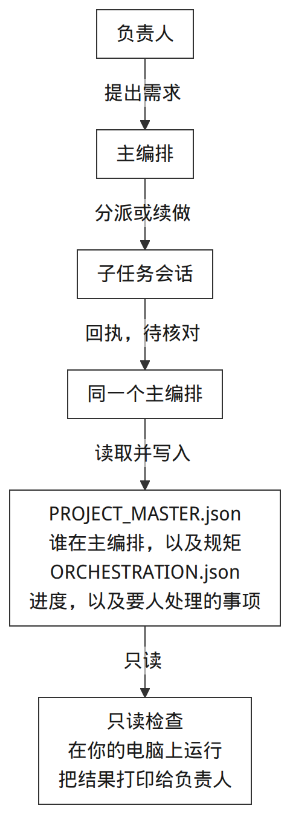
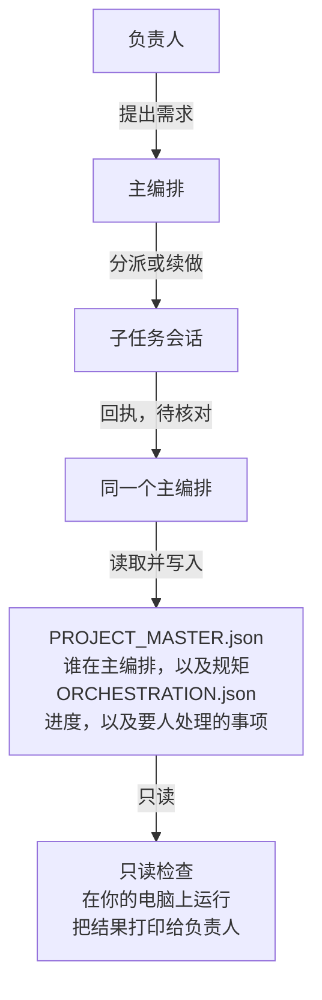

[English](README.md) | 简体中文

# PMOP

PMOP 目前还是实验版本。一个多任务项目只保留一个主编排，用项目目录里的两份 JSON 记住做到哪了，再用只读脚本检查这两份文件。



<details>
<summary>图源码</summary>



</details>

主编排读写这两份文件。`scripts/orchestration_state.py` 里的 `validate` 和 `owner-inbox` 在你的电脑上运行，只读这两份文件。子任务会话只有在交接里写明 `ORCHESTRATION.json` 和修订号时，才会写这份文件。

主编排就是这个项目接收需求、分派工作、验收结果的那个会话。项目一旦拆进多个代理对话，下一轮就很难分清结果归谁、哪些已经验收、哪些还卡在负责人身上；这些内容只留在聊天记录里，下次接不上。PMOP 把这份记录放回项目目录：`PROJECT_MASTER.json` 记身份和规矩，`ORCHESTRATION.json` 记当前结果和负责人关口，[SKILL.md](SKILL.md) 约定主编排如何接需求、分派、交接、验收，以及如何把主编排交给下一次对话。

适合已经在用代理做项目、又希望每个项目只有一个入口来收需求、分派和验收，并把真正要人处理的事项单独列出来的人。使用方式是读这份约定，并把两份文件放在项目里。

## 它负责什么，不负责什么

**仓库里有的**

- 一份书面约定：[SKILL.md](SKILL.md)，以及 [references/](references/) 里的三份契约。
- 放在项目里的两份 JSON。[templates/](templates/) 是虚构起点，路径和线程 id 都是占位符。
- 三个只依赖 Python 标准库的脚本：`orchestration_state.py` 检查项目或打印负责人收件箱，`capability_index.py` 列出你指定目录中的 `SKILL.md`，`demo.py` 跑一次用完即删的演示。
- 把这套约定对到 Codex 或 Hermes 上的人工说明，见 [adapters/README.md](adapters/README.md)。

**仓库不提供的**

- 创建任务、运行代理、后台调度、权限控制，或自动同步项目。
- 完成、授权和证据真伪。校验通过，只说明 `scripts/orchestration_state.py` 里的结构检查通过了。
- 已经跑通的宿主接入。Codex 与 Hermes 的说明来自阅读接口；适配契约里的认证步骤还没有做。Claude 在审查记录里只是计划中的宿主，没有读过接口，也没有运行记录。
- 默认允许自动开子任务、自动提交，或对外操作。发布用的模板把子任务设为 `manual`，把本地提交和对外操作都设为 `owner_confirmation`。

这里说的协议，是上面这份给人和代理遵守的书面约定。脚本是本机上的检查工具。真正跑对话的代理产品，文档里称为宿主。

## 一分钟试用

需要 Python 3.10 或更新版本，只用标准库，不用安装依赖。在仓库根目录执行：

```sh
python3 scripts/demo.py
python3 -m unittest discover -s tests -v
python3 scripts/capability_index.py --root . --format json
python3 scripts/capability_index.py --root ./examples --format json
```

Windows 上如果没有 `python3` 命令，把命令名换成 `python`，参数不变。

- `demo.py` 读取本仓库里的虚构模板，在临时目录写成一个项目，做校验，打印一条负责人决策，然后删掉该目录。它不读取宿主配置。开头一行状态是英文。收件箱标题是中文（`需要我亲手操作`、`需要我拍板`）。示例决策的正文是英文，因为 `scripts/demo.py` 里的虚构事项就是英文。
- unittest 那条命令运行 [tests/](tests/) 里的测试。
- 对 `.` 的盘点列出该路径下每份 `SKILL.md`，包含相对路径、字节数和 SHA-256。当前仓库里是根目录的 `SKILL.md`。状态字符串是 `installed files only; runtime visibility unverified`，意思是只统计磁盘上的文件，看不出宿主有没有加载它们。
- 对 `./examples` 的盘点是空列表。该目录没有 `SKILL.md`。脚本只搜索你点名的目录。不传 `--root` 时退出码为 2。

## 概念

| 名称 | 作用 |
| --- | --- |
| 主编排 | 每个项目一个。接需求、分派、验收，也可以把这个身份交给下一次会话。 |
| `PROJECT_MASTER.json` | 稳定 id、显示名、治理目录、代码目录、当前主编排线程和策略。模板使用 schema 2。schema 1 仍能通过校验，同时给出警告。 |
| `ORCHESTRATION.json` | 修订号、治理状态、进行中的结果、仍开放的负责人关口，以及旧来源指针。schema 固定为 1。模板允许三个进行中的结果，这也是硬上限。项目可以把 `max_active_outcomes` 设得更小。 |
| 治理目录 | 存放这两份 JSON 的目录。实际改代码、跑命令的代码目录可以是另一处。 |
| 进行中的结果 | 当前要交付的一项：稳定的 `outcome_key`、优先级、路线、子任务线程、范围、最近一次核对、下一步。优先级互不重复，并从 1 连续排列。 |
| 负责人关口 | 必须负责人亲自做的 `owner_action`，或可以凭材料作决定的 `owner_decision`。代理自己能做的事不放进这张表。正在使用的文件里，关口状态只能是 `open`。 |
| 任务包 / 增量包 | 新子任务发完整任务包，之后只发变化了的内容。模板默认：标题 30 个字符，任务包目标 800、上限 1400，增量包上限 500，输入文件引用最多 5 个。 |
| 子任务寿命 | `one_shot` 在交付完成或被挡住时回执。`exploratory` 可以跨很多轮继续做。线程空闲时，这项工作仍算开着。 |
| 治理状态 | `healthy`（正常）、`degraded`（降级）、`blocked`（阻塞）。降级时，范围清楚且可以回退的本地工作仍可继续。推送、发布、部署和破坏性操作，要等状态重新核对之后再做。 |

约定里还会把工作标成 `current_thread`、`blueprint`、`backlog`、`needs_clarification`、`handoff` 或 `archive`。写进 `active_outcomes` 时，校验器只接受 `quick_fix` 和 `isolated_task`。

证据用六个词标注：`confirmed`、`observed`、`inferred`、`assumed`、`unknown`、`blocked`。这是约定里的用语，校验器不给它们打分。

动手做一块工作之前，约定要求主编排先说明准备做什么、主要风险，以及第一个该停的点。模板里的提示原文是 `准备｜风险｜停点`。

细节见 [主编排契约](references/project-master-contract.md)、[编排状态契约](references/orchestration-contract.md)、[子任务交接](references/child-task-handoff.md)。

## 用法

把模板拷进项目之后，先替换其中的占位路径和线程 id，再把这两份文件当作真实状态。下面这段 shell 在临时目录里替换路径、跑检查，然后删除该目录，可在 Linux 和 macOS 上运行。线程 id 仍是模板里的占位符。在仓库根目录执行：

```sh
set -eu
root=$(mktemp -d /tmp/pmop-example-XXXXXX)
cp templates/PROJECT_MASTER.json templates/ORCHESTRATION.json "$root/"
python3 -c '
import json, sys
from pathlib import Path
root = Path(sys.argv[1]).resolve()
master = json.loads((root / "PROJECT_MASTER.json").read_text(encoding="utf-8"))
master["governance_root"] = str(root)
master["code_roots"] = [str(root)]
master["state_backend"]["orchestration_file"] = str(root / "ORCHESTRATION.json")
master["project_name"] = "Fictional local example"
(root / "PROJECT_MASTER.json").write_text(json.dumps(master, indent=2) + "\n", encoding="utf-8")
' "$root"
python3 scripts/orchestration_state.py validate --root "$root" --json
python3 scripts/orchestration_state.py owner-inbox --root "$root" --format json
rm -rf "$root"
```

`validate --json` 会打印 `valid`、`errors` 和 `warnings`。覆盖到的检查都通过时退出码为 0，有检查失败时为 1。相对路径的 `--root` 按当前工作目录解析。JSON 里的 `code_roots` 必须是绝对路径；`governance_root` 会和你传入的目录作比较。

多个项目合成一份收件箱时，重复传入 `--root`。每个目录都要同时有这两份文件，并且校验通过。其中一个失败时，命令把该目录的结果打到 stderr，退出码为 1，不打印收件箱。默认收件箱是中文 Markdown。`--format json` 输出同样的关口数据。留在正在使用的文件里的关口，状态必须是 `open`，其他状态会导致校验失败。收件箱上的项目 id、项目名和项目根目录，取自该项目的主编排文件和你传入的目录。关口对象里如果已经有这三项，输出仍以主编排文件和你传入的目录为准。

`capability_index.py` 可以重复传入 `--root`，输出 JSON 或 Markdown。它只列出仍位于这些目录之内的 `SKILL.md`，记录相对路径、字节数和 SHA-256；同一摘要出现多次时标上 `exact_duplicate`。解析后跑到指定目录外面的符号链接会被跳过。输出里仍可能有敏感的相对路径，按私有资料保管。这条命令不读宿主配置，也不访问网络。

直接对 [templates/](templates/) 做校验，可能得到 `"valid": true`，同时警告 `governance_root` 和该目录不一致。那里的路径和线程 id 是占位符。真实的控制文件、任务历史、宿主配置、凭据和盘点输出，不要放进准备公开的文件。本仓库忽略根目录的 `/PROJECT_MASTER.json`、`/ORCHESTRATION.json` 和 `/private-evidence/`。

`agents/openai.yaml` 只是一段显示名和默认提示，给已经知道如何读取该文件的宿主用。

## 目录

- [SKILL.md](SKILL.md) — 接需求、分派、交接、验收、归档和主编排换任。
- [references/](references/) — 主编排文件、编排文件和子任务包的契约。
- [templates/](templates/) — 虚构的初始文件。
- [scripts/](scripts/) — 校验、收件箱、文件盘点和演示。
- [tests/](tests/) — unittest 测试。
- [adapters/](adapters/) — 共用的适配规则，以及 [Codex](adapters/codex.md) 和 [Hermes](adapters/hermes.md) 的人工说明。
- [examples/](examples/) — 一个没有 `SKILL.md` 的盘点目标，说明见 [examples/README.md](examples/README.md)。
- [docs/](docs/) — 发布审查和本地验证记录。

## 现状与限制

仍是实验版本。公开的是这套约定、只读工具、虚构模板、测试、文档和 CI 配置。

- [adapters/README.md](adapters/README.md) 里的认证还没有做：在虚构工作区里拿到真实子任务 id，独立核对产物，写回项目状态，再从这份状态恢复；并覆盖被挡住的结果、重复分派和中断。
- Codex 说明记录的是 2026-11-08 本机 `codex` CLI 0.145.0 的 `exec` 与 `resume` 帮助。这个项目没有从这里跑过一次 Codex 任务。
- Hermes 说明记录的是本机源码快照 `aaa863f7ff` 里的 `delegate_task`（`spawn`、`list`、`steer`、`stop`）。探测 CLI 版本时访问了资源服务器，被执行策略拦住，没有重试。委托、取回结果、验收、再恢复这一路没有跑过。
- Claude 在审查记录里只是计划中的名字。
- 校验器就是 `scripts/orchestration_state.py` 里写明的那些检查，不是一份完整的 JSON Schema。它不要求路径真实存在，也不判断证据真伪。
- 单一写入者和修订号核对，是主编排会话要遵守的规则。脚本不加文件锁，也不合并并发写入。
- 默认收件箱是给人读的中文 Markdown，是一张生成出来的视图。每个项目的主编排仍然是该项目文件的写入者。
- 能力盘点只列出磁盘上的文件。某个宿主是否已经加载、启用，或是否授予了工具，要在那个宿主里另查。
- 控制文件按 UTF-8 读写。演示和两个命令行脚本都会把自己的标准流设成 UTF-8。

[.github/workflows/tests.yml](.github/workflows/tests.yml) 会在 Ubuntu、macOS 和 Windows 上，用 Python 3.10 和 3.13 运行 unittest 和 `scripts/demo.py`。[docs/VERIFICATION.md](docs/VERIFICATION.md) 记录了 2026-11-08 的一次本地运行（macOS，Python 3.15.0），以及第一次远程运行里 Linux 和 macOS 通过。同一份记录写明，第一次 Windows 运行失败，原因是演示当时用了系统默认文本编码；脚本现在改为显式 UTF-8。某次提交在这些系统和 Python 版本上的结果，以该提交的 Actions 记录为准。

## 许可证

[MIT](LICENSE)。Copyright (c) 2026 dlxeva。

维护者已于 2026-11-08 确认原始内容为本人创作，并授权以此发布。审查范围见 [docs/RELEASE_REVIEW.md](docs/RELEASE_REVIEW.md) 和 [docs/VERIFICATION.md](docs/VERIFICATION.md)。
